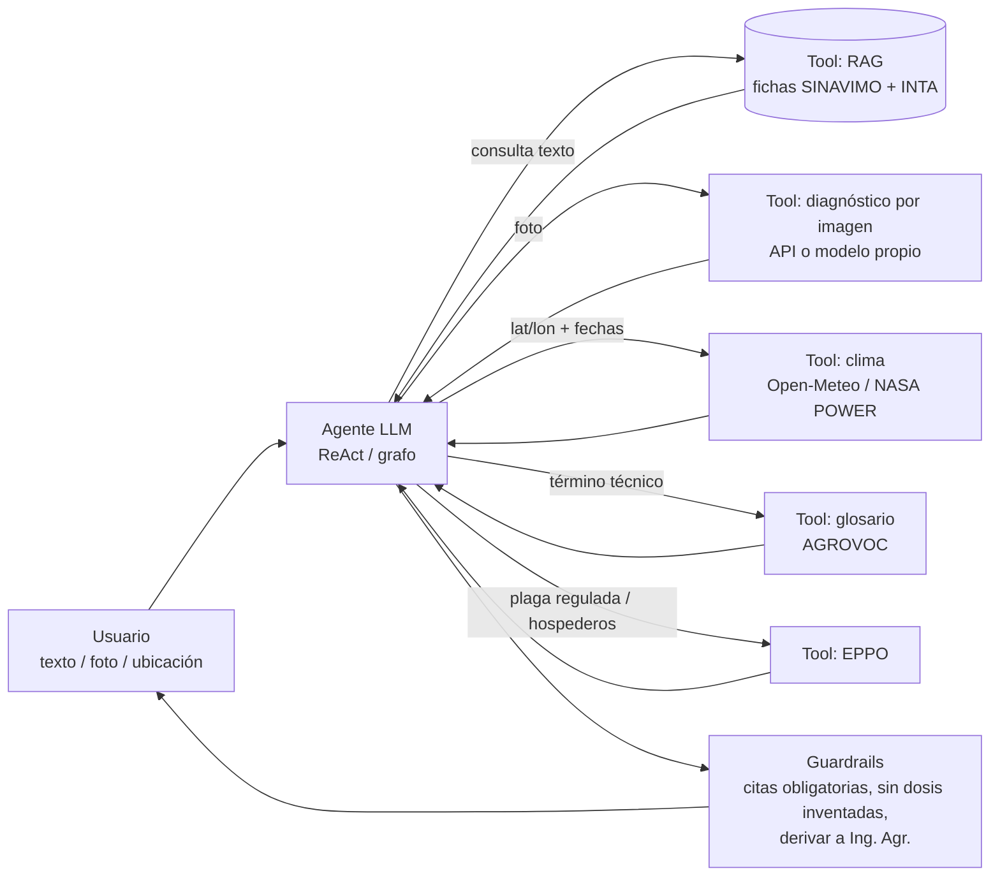

# TP2 — Agente de consulta agronómica (plagas, enfermedades y malezas)

> **Estado:** v1 · 24/10/2026 — documento de ideas y fuentes original. Lo implementado está en el resto de la carpeta (ver `README.md`).
> **Pendiente:** alinear con el repo de la materia (la sección 5 está armada para mapear cada tema del repo a una pieza del agente).
> **Actualización 25/10/2026:** el último informe de la Red Nacional de Monitoreo es el **N° 52 (20/10/2026)**, ya descargado en `data/corpus/chicharrita/`.

---

## 1. La idea en una línea

Un agente conversacional que responde consultas fitosanitarias de cultivos extensivos de la región centro (maíz, soja, trigo): identifica la plaga/enfermedad (por texto o foto), explica síntomas y condiciones que la favorecen **citando fuentes oficiales argentinas**, cruza eso con el clima del lote y orienta el manejo, sin reemplazar al ingeniero agrónomo.

**Por qué tiene sentido ahora (para la motivación del informe):**
- La chicharrita del maíz sigue siendo tema: el informe N° 48 de la Red Nacional de Monitoreo (agosto 2026) muestra capturas bajas en Centro-Sur y Litoral, pero NOA, NEA y Centro-Norte por encima de 2025, con portación de *Spiroplasma* en puntos de Córdoba y Santa Fe ([Infobae / Revista Chacra](https://www.infobae.com/revista-chacra/2026/08/27/la-chicharrita-afloja-pero-el-maiz-no-puede-bajar-la-guardia/)). INTA además alertó por alta presencia para la campaña 2026/27 ([Sur Santiagueño](https://sursantiago.com.ar/campo/2026/08/10/alerta-en-la-region-productiva-el-inta-advierte-por-una-alta-presencia-de-chicharrita-para-la-campana-de-maiz-2026-27)).
- Malezas resistentes: el mapeo 2025 de Aapresid habla de ~26 millones de ha con al menos una maleza resistente o tolerante ([Camponea](https://camponea.com/casi-26-millones-de-hectareas-tienen-al-menos-una-maleza-resistente-o-tolerante/), [Agroverdad](https://agroverdad.com.ar/2025/09/malezas-resistentes-un-mapeo-actualizado-muestra-que-avanzaron-en-argentina-hay-mas-de-25-millones-de-has-afectadas)).
- La información existe pero está dispersa (SENASA, INTA, Aapresid, bolsas, CASAFE) y en formatos poco consultables (PDFs, fichas web). Un agente que la unifique y la cite es un caso de uso real.

---

## 2. Variantes de alcance (elegir una)

| Variante | Qué hace | Dificultad | Comentario |
|---|---|---|---|
| **A. Agente RAG fitosanitario** | Preguntas en texto → busca en fichas SINAVIMO + docs INTA → responde con citas | Baja-media | Base mínima sólida |
| **B. A + diagnóstico por foto** ⭐ | Además recibe una foto de hoja/insecto y propone candidatos | Media | **Recomendada**: luce en la demo, usa visión + tools |
| **C. B + riesgo climático** | Cruza las "condiciones predisponentes" de la ficha con pronóstico/humedad del lote (Open-Meteo) | Media-alta | Diferencial fuerte, poco código extra |
| **D. Multi-agente** | Orquestador + sub-agentes (diagnosticador, "agrónomo" RAG, meteorólogo) | Alta | Solo si el repo de la materia trabaja multi-agente |

**Recomendación:** B como objetivo, C como extra si sobra tiempo (es "barato" porque las fichas SINAVIMO ya traen un campo de condiciones predisponentes — ver §4.1).

### Preguntas de ejemplo que el agente debería resolver
- "Tengo hojas de maíz con pústulas color óxido, ¿qué puede ser y cómo lo confirmo?"
- "¿Qué es la chicharrita, qué enfermedad transmite y cómo está el monitoreo en el centro-norte?"
- "Esta foto es de una hoja de soja de mi lote en Río Cuarto, ¿qué ves?" (+ imagen)
- "Con el pronóstico de esta semana en [lat, lon], ¿hay condiciones favorables para enfermedades fúngicas en trigo?"
- "¿Qué malezas resistentes a glifosato hay reportadas en mi departamento?"
- "¿Qué significa *nivel de daño económico*?" (glosario)

---

## 3. Arquitectura propuesta

**Flujo típico (variante B/C):**
1. El usuario manda foto + "maíz, Córdoba".
2. El agente llama a la tool de imagen → top-3 candidatos con confianza.
3. Por cada candidato, RAG sobre fichas → síntomas distintivos, condiciones predisponentes.
4. (C) Llama a clima → humedad, temperatura, probabilidad de mojado de hoja de los próximos días.
5. Responde: diagnóstico probable + cómo confirmarlo a campo + riesgo según clima + **fuentes** + aviso de consultar a un profesional para cualquier aplicación.

**Guardrails clave (suman puntos en el informe):**
- No inventar dosis ni productos: si preguntan "¿qué le aplico?", responder con principios de manejo y derivar a la [Guía de CASAFE](https://www.casafe.org/publicaciones/guia-de-productos-fitosanitarios/) y a la receta agronómica ([CASAFE — Receta fitosanitaria](https://www.casafe.org/receta-fitosanitaria/)). En Córdoba los agroquímicos están regulados por la [Ley 9164](https://www.cba.gov.ar/wp-content/4p96humuzp/2013/05/9164-Agroqu%c3%admicos.pdf) y la provincia usa una [receta fitosanitaria digital con trazabilidad](https://www.potatopro.com/news/2021/argentina-cómo-es-la-nueva-receta-fitosanitaria-digital-de-córdoba-que-incluye) — buen argumento para que el agente **derive** en vez de recetar.
- Toda afirmación técnica con fuente (URL de la ficha / documento).
- Si la confianza de la imagen es baja → pedir otra foto (haz y envés, planta completa, insecto en primer plano).
- Memoria de sesión: cultivo, ubicación, estado fenológico, para no volver a preguntar.

---

## 4. Fuentes y material encontrado

### 4.1 Fuentes oficiales argentinas (base de conocimiento del RAG)

| Fuente | Qué tiene | Acceso | Uso en el agente |
|---|---|---|---|
| **[SINAVIMO (SENASA)](https://www.sinavimo.gob.ar/)** | Portal oficial de vigilancia y monitoreo de plagas, mantenido por la Dirección de Información Estratégica Fitosanitaria del SENASA; acceso libre y gratuito ([acerca de](https://www.sinavimo.gob.ar/acerca-de-sinavimo)) | Web, sin API documentada | **Núcleo del RAG.** Cada ficha (ej. [*Bipolaris sorokiniana*](https://www.sinavimo.gob.ar/plaga/bipolaris-sorokiniana)) trae: nombre vulgar, sinonimia, tipo de plaga, taxonomía, condición en el país, cultivos/órgano afectado, descripción biológica, signos y síntomas, **condiciones predisponentes** y bibliografía |
| [SENASA — Consulta de status de plagas](https://www.argentina.gob.ar/senasa/portal-de-certificacion-fitosanitaria-de-exportacion/consulta-de-status-de-plagas-en-argentina) | Estatus de plagas en Argentina | Web | Responder "¿está presente en Argentina?" |
| **[INTA — Red Nacional de Monitoreo de chicharrita](https://www.argentina.gob.ar/inta/achaparramiento-del-maiz/red-nacional-de-monitoreo-informes)** | Informes PDF numerados desde jul-2024 (la página de INTA lista hasta el N° 21; el resto en MAIZAR, p. ej. [informe N° 31](http://www.maizar.org.ar/documentos/31%20informe%20de%20la%20red%20nacional%20de%20monitoreo.pdf)) | PDF | RAG temporal: "¿cómo viene la chicharrita en mi región?" |
| [INTA Reconquista — monitoreo 2026](https://www.argentina.gob.ar/noticias/monitoreo-de-la-chicharrita-del-maiz-y-patogenos-asociados-inta-reconquista-2026) | Monitoreo regional de chicharrita y patógenos | Web | Complemento |
| **[INTA Digital (repositorio)](https://repositorio.inta.gob.ar/handle/20.500.12123/361/browse?type=title)** | Repositorio institucional de acceso abierto del INTA (publicaciones técnicas, informes) | Web / PDF | Bajar 10–20 guías de manejo de plagas de maíz/soja/trigo |
| **[REM Aapresid — Mapa de malezas](https://www.aapresid.org.ar/rem-malezas/mapa-malezas/)** | Presencia de biotipos resistentes/tolerantes por partido/departamento (rojo = resistencia confirmada, amarillo = sospechada, naranja = tolerancia), abundancia de 6 malezas, filtros por herbicida y año; 200 partidos de 10 provincias; actualizaciones bienales hasta 2025 | Web interactiva | Tool o RAG para "¿qué malezas resistentes hay en mi zona?" |
| [CASAFE — Guía de Productos Fitosanitarios](https://www.casafe.org/publicaciones/guia-de-productos-fitosanitarios/) | Productos registrados por SENASA: usos, toxicología, carencia, dosis. Web solo con registro; app gratuita iOS/Android | Registro | **Solo como derivación/link**, no scrapear (y no queremos que el agente recomiende dosis) |
| [ORA — Reservas de agua en suelo](https://datos.magyp.gob.ar/dataset/ora---reservas-agua-suelo) | Shapes/JPG semanales por cultivo + índice satelital TVDI (oct–abr), licencia ODbL. Ojo: la metadata dice última actualización 2019 | Descarga | Opcional / contexto; para clima conviene Open-Meteo |
| [Datos Argentina — Maíz: siembra, cosecha, producción, rendimiento](https://datos.gob.ar/dataset/agroindustria-maiz---siembra-cosecha-produccion-rendimiento) (+ [búsqueda por cultivo](https://datos.gob.ar/dataset?tags=maiz)) | Estimaciones agrícolas por campaña (verificar columnas al descargar) | CSV | Opcional: contexto productivo por departamento |
| Bolsa de Cereales de Bs. As. (Panorama Agrícola Semanal) y [BCR — GEA](https://www.bcr.com.ar/es/print/pdf/node/98573) | Estado semanal de cultivos | PDF | Opcional, RAG de coyuntura |

### 4.2 Bases internacionales y vocabularios

| Fuente | Qué tiene | Acceso | Uso |
|---|---|---|---|
| **[EPPO Global Database](https://eppo.int/RESOURCES/eppo_databases/global_database)** | >97.800 especies (nombres, sinónimos, taxonomía, códigos EPPO), >1.900 plagas reguladas con hospederos y distribución mundial, >15.000 fotos (datos a sep-2024) | Registro gratuito → **API REST** en data.eppo.int (Open Data Licence) | Tool de hospederos/distribución; normalizar nombres científicos. Hay wrapper en R: [pestr](https://search.r-project.org/CRAN/packages/pestr/pestr.pdf) |
| **[AGROVOC (FAO)](https://www.fao.org/agrovoc/machine-use)** | Tesauro agrícola multilingüe | SPARQL `https://agrovoc.fao.org/sparql` y REST Skosmos `https://agrovoc.fao.org/browse/rest/v1/` | Tool de glosario / sinónimos ES↔EN (mejora el retrieval) |
| [GBIF](https://analytics-files.gbif.org/country/AR/GBIF_CountryReport_AR.pdf) / iNaturalist | Ocurrencias georreferenciadas de especies | API pública | Opcional: "¿se registró este insecto cerca?" |

### 4.3 Datasets de imágenes (para la tool de diagnóstico)

| Dataset | Tamaño / clases | Licencia | Nota |
|---|---|---|---|
| **[PlantVillage (TFDS `plant_village`)](https://www.tensorflow.org/datasets/catalog/plant_village)** | 54.303 imágenes, 38 clases (especie+enfermedad), ~830 MB | Revisar fuente original ([Mendeley](https://data.mendeley.com/datasets/tywbtsjrjv/1)) | Fotos de laboratorio, fondo uniforme → **generaliza mal a campo** ([paper original](https://arxiv.org/pdf/1604.03169)) |
| **[PlantDoc](https://github.com/pratikkayal/PlantDoc-Dataset)** | 2.598 imágenes, 13 especies, 17 clases | CC BY 4.0 | Imágenes "de campo" reales; hay versión para detección en [Roboflow](https://public.roboflow.com/object-detection/plantdoc). Ideal para **evaluar** ([paper](https://arxiv.org/pdf/1911.10317)) |
| **[Corn Leaf Disease (Mendeley, 2026)](https://data.mendeley.com/datasets/hmkd6nbngr)** | ~17.000 imágenes de maíz, 5 clases: roya común, tizón, mancha gris, sana, daño por insectos | CC BY 4.0 | Muy alineado con maíz de la región |
| **[IP102](https://mmcheng.net/ip102/)** ([GitHub](https://github.com/xpwu95/IP102)) | 75.222 imágenes, 102 plagas de insectos; 18.976 con bounding boxes | Académica | Para identificar insectos; trae modelos preentrenados |
| [Digipathos (Embrapa)](https://digipathos.readthedocs.io/en/latest/about.html) | Imágenes de patologías de plantas de Embrapa (Brasil); wrapper Python | Pública | Cultivos de la región (soja, etc.) — revisar contenido |

### 4.4 APIs útiles para las tools

| API | Para qué | Costo / límites | Nota |
|---|---|---|---|
| **[Kindwise crop.health](https://www.kindwise.com/crop-health)** | Identifica plagas/enfermedades por imagen en 23 cultivos (incluye maíz, soja, trigo, cebada y papa; **no** girasol ni maní) y ~288 problemas; devuelve síntomas, severidad y tratamiento; idioma configurable | **100 créditos gratis** al registrarse (1 crédito = 1 identificación); luego desde €0,05/crédito ([pricing](https://kindwise.com/pricing)) | Ideal para la demo; cachear respuestas para no gastar créditos. Demo en [crop.kindwise.com](https://crop.kindwise.com/demo) |
| [Pl@ntNet API](https://my.plantnet.org/doc/api/quota) | Identificación de **especies** de plantas (no enfermedades según el [changelog](https://my.plantnet.org/doc/changelog)) | Cuota diaria gratuita por usuario (consultar `/v2/quota`) | Útil para identificar **malezas**. Existe un servidor MCP: [plantnet-mcp](https://github.com/OrHavraPerry/plantnet-mcp) |
| **[Open-Meteo](https://open-meteo.com/en/docs)** | Pronóstico + histórico: `soil_moisture_*`, `soil_temperature_*`, `et0_fao_evapotranspiration`, `vapour_pressure_deficit`, `precipitation`; también probabilidad de mojado de hoja (diaria) | Gratis sin API key para uso no comercial, hasta 10.000 llamadas/día, CC BY 4.0 | **La mejor opción para la tool de clima.** Histórico ERA5 desde 1940 |
| [NASA POWER](https://power.larc.nasa.gov/docs/methodology/communities/) | Series diarias por punto (comunidad AG = agroclimatología), `GET .../api/temporal/daily/point` | Gratis, sin key | Alternativa/backup de clima histórico |
| Modelo de visión multimodal (VLM) del LLM que use la materia | Describir la foto y proponer candidatos | Según proveedor | Fallback si no se usa crop.health; comparar ambos en la evaluación |

### 4.5 Proyectos y papers similares (para el marco teórico)

- **[Farmer.Chat (Digital Green)](https://arxiv.org/html/2409.08916v2)** — el referente más claro. Pipeline RAG con detección de intención, reformulación, recuperación + reranking y generación; base de conocimiento validada por expertos; voz e imágenes; desplegado en Kenia, India, Etiopía y Nigeria con >15.000 productores y >300.000 consultas. Responden ~75% de las consultas, y dos tercios de las no respondidas se deben a **huecos de contenido** (lección: la base de conocimiento importa más que el modelo).
- **[Evaluación de Farmer.Chat con LLM-as-a-judge (Hugging Face)](https://www.huggingface.co/blog/digital-green-llm-judge)** — miden fidelidad descomponiendo la respuesta en afirmaciones atómicas y chequeando cada una contra el contexto (estilo RAGAS), validado contra ~360 preguntas evaluadas por humanos; remarcan medir también la **tasa de respuesta**, no solo la fidelidad. **Copiar esta metodología para el TP.**
- **[Agentic AI for Smart Agriculture (ReadyTensor)](https://app.readytensor.ai/publications/agentic-ai-for-smart-agriculture-a-multimodal-rag-system-for-crop-disease-detection-diagnosis-mLRSML10lEYd)** — YOLOv8 para detectar enfermedad + RAG en Qdrant (embeddings all-MiniLM-L6-v2) + LLM vía Groq + TTS; evaluado con RAGAS. Muy parecido a la variante B: sirve de referencia de stack.
- **[LLMI-CDP (Scientific Reports, 2025)](https://www.nature.com/articles/s41598-025-01908-0)** — LLM multimodal (VisualGLM + LoRA) para identificar enfermedades y plagas y recomendar prevención; dataset propio de 2.498 imágenes y 141 categorías.
- Lecturas opcionales: [Plant Disease Detection through Multimodal LLMs (arXiv 2504.20419)](https://arxiv.org/pdf/2504.20419) · [Reasoning-based foundation models for site-specific pest management (arXiv 2510.24650)](https://arxiv.org/html/2510.24650v1) · [LLMs y VLMs en fenotipado de estrés (ScienceDirect)](https://www.sciencedirect.com/science/article/pii/S2643651525001670).

---

## 5. Mapeo con los temas de la materia

Repo de la cátedra: https://github.com/lauraceciliadiazdavila/IA-LIDeSIA-Dpto-Computacion (FCEFyN – UNC, LIDeSIA). Unidades: intro al entorno, regresión, árboles CART, SVM, K-means, HAC, MLP, CNN, RNN, autoencoders, YOLO, series temporales y **17_Agentes**, que es la base del TP2.

| Tema del repo | Pieza del agente que lo usa |
|---|---|
| `17_Agentes/Agente_ReAct.ipynb`: HF Router + `Tool` + prompt ReAct + parser + loop | `agente/llm.py`, `agente/react_manual.py` |
| `17_Agentes/Agente_LangChain.ipynb`: `@tool`, `create_agent`, skills como tools | `agente/agente_langchain.py`, skill `evaluar_riesgo` |
| "RAG Agents" (próximos pasos de la notebook) | `buscar_fichas` sobre SINAVIMO + informes de chicharrita |
| `13_YOLO` / `10_CNN` (visión) | Etapa 2: diagnóstico por foto (tools ya preparadas) |
| `18_Forecasting` / series temporales | Idea a futuro: serie de capturas de chicharrita por región |

Detalle en `docs/07-agente-consultas.md`.

---

## 6. Evaluación (lo que más suma en la nota)

1. **Set dorado de 30–50 preguntas** con respuesta esperada y fuente (sacadas de las fichas SINAVIMO e informes INTA). Mezclar: factuales, de síntomas, temporales (chicharrita), fuera de alcance ("¿qué dosis de X aplico?") y trampas (plaga inexistente).
2. **Métricas RAG:** fidelidad (afirmaciones respaldadas por contexto), relevancia de la respuesta, **tasa de respuesta** y tasa de rechazo correcto en preguntas fuera de alcance. LLM-as-judge + validación manual de una muestra (como Farmer.Chat).
3. **Métricas de imagen:** top-1 / top-3 accuracy sobre ~50 imágenes de **PlantDoc** y del dataset de maíz (no sobre PlantVillage: es de laboratorio). Comparar crop.health vs. VLM genérico.
4. **Ablation simple:** respuesta sin RAG vs. con RAG (muestra el valor del agente).

---

## 7. Riesgos y cómo mitigarlos

| Riesgo | Mitigación |
|---|---|
| SINAVIMO no tiene API | Descargar a mano/script respetuoso solo las ~30–60 fichas de los cultivos elegidos; guardar en Markdown con metadata (cultivo, tipo, URL, fecha) |
| Modelos entrenados en PlantVillage fallan en campo | Evaluar con PlantDoc / maíz; pedir mejores fotos si la confianza es baja |
| Créditos limitados de crop.health (100) | Cachear respuestas; usar VLM como fallback; reservar créditos para evaluación y demo |
| Alucinación de productos/dosis | Guardrail explícito + derivación a CASAFE y receta agronómica; caso de prueba en el set dorado |
| Datos desactualizados (ej. ORA 2019) | Mostrar fecha de la fuente en cada respuesta |
| Alcance demasiado grande | Fijar 3 cultivos, región centro, ~30 plagas/enfermedades/malezas |

---

## 8. Plan de acción compacto

> Ajustar días a la fecha de entrega.

| Fase | Qué | Entregable | Tiempo |
|---|---|---|---|
| **0. Definir** | Leer repo de la materia, elegir variante (B recomendada), cultivos (maíz/soja/trigo) y lista de ~30 plagas/enfermedades/malezas | Alcance de 1 página | 1 día |
| **1. Corpus** | Bajar fichas SINAVIMO de esa lista + 3–5 informes chicharrita + 10 docs INTA; convertir a Markdown con metadata | `data/corpus/` | 2 días |
| **2. RAG** | Chunking por sección de ficha, embeddings multilingües, vector DB, retriever con filtro por cultivo; prompt con citas | Tool `buscar_fichas()` | 2 días |
| **3. Tools** | `diagnosticar_imagen()` (crop.health + fallback VLM), `clima_lote()` (Open-Meteo), `glosario()` (AGROVOC); opcional `malezas_zona()` | Tools testeadas aisladas | 2–3 días |
| **4. Agente** | Loop/grafo del agente según el repo, memoria de lote, guardrails | Agente funcionando en consola | 2 días |
| **5. Evaluar** | Set dorado + imágenes PlantDoc/maíz, métricas de §6, ablation | Tabla de resultados | 2 días |
| **6. Cerrar** | UI simple (Streamlit/Gradio o lo que use la cátedra), README, informe, video/demo | Repo + informe | 1–2 días |

**Checklist mínimo para aprobar:** corpus citado ✔ · RAG con citas ✔ · ≥2 tools reales ✔ · agente con loop ✔ · guardrails ✔ · evaluación con números ✔ · demo ✔

**Para destacar:** variante C (riesgo climático a partir de "condiciones predisponentes" + Open-Meteo) · comparación crop.health vs. VLM · tools expuestas por MCP.
